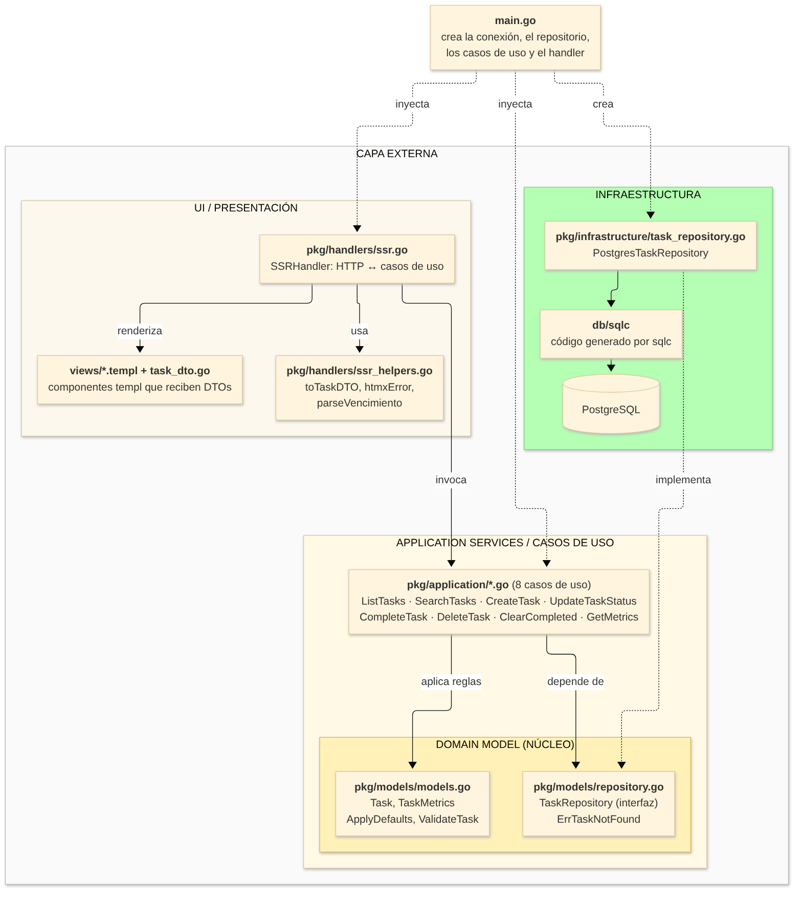
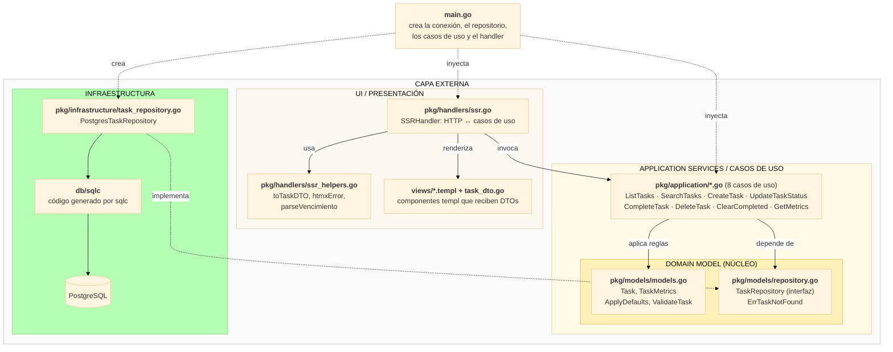
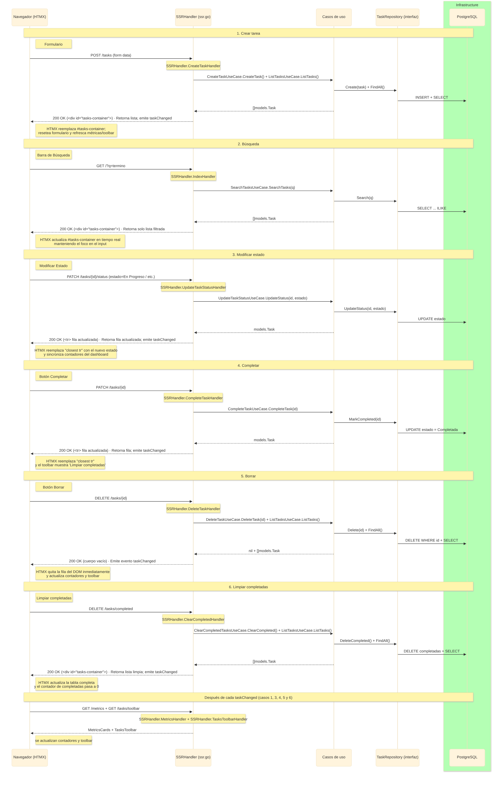
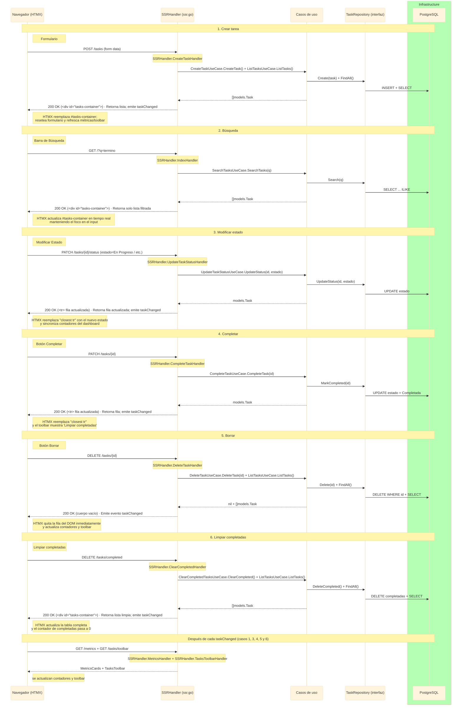

# Trabajo de Cursada — Entrega 6: Interfaces Reactivas con HTMX

## App de Gestión de Tareas (To-Do List)

Sexta y última entrega del Trabajo Práctico de cursada. En esta etapa se evoluciona la aplicación web renderizada en el servidor (SSR con Go y Templ) hacia una experiencia reactiva tipo **SPA** mediante **HTMX** y estilos con **Pico.css**, eliminando recargas completas de página **sin escribir una sola línea de código JavaScript propio**.

> **Estrategia y Organización de Ramas Git:**
>
> - Rama `tp1`: Entrega 1 (Definición del dominio y servidor HTTP básico).
> - Rama `tp2`: Entrega 2 (Persistencia con PostgreSQL, sqlc, pruebas de base de datos y automatización).
> - Rama `tp3`: Entrega 3 (API REST completa con endpoints CRUD, filtros, validaciones y pruebas con Hurl).
> - Rama `tp5`: Entrega 5 (Arquitectura SSR con componentes Templ, formularios clásicos PRG y estilos Pico.css).
> - **Rama `tp6`**: **Entrega 6 (Final)**: Interfaces reactivas con HTMX, Arquitectura Onion, integración de métricas/búsqueda/limpieza de TP anteriores, casos de uso, DTOs de vista, marcado de completado (`PATCH`), borrado dinámico (`DELETE`) y automatización desatendida.

---

## 1. Arquitectura de la aplicación: Arquitectura Onion

Para desacoplar completamente la lógica de negocio, la persistencia y la capa de presentación web, se estructuró el backend bajo los principios de la **Arquitectura Onion**. En esta arquitectura, **todas las dependencias apuntan exclusivamente hacia el centro** (el dominio), aplicando inversión de dependencias:



<details>
<summary>Ver código fuente Mermaid</summary>



</details>

---

### Capas del Sistema:

1. **Domain Model (Núcleo — `pkg/models`):**
   - **Entidad `Task`:** Representa la tarea del negocio (`ID`, `Titulo`, `Descripcion`, `Estado`, `Prioridad`, `CreadoEn`, `Vencimiento`).
   - **Entidad `TaskMetrics`:** Agregado cuantitativo del estado del sistema (`Total`, `Pendientes`, `EnProgreso`, `Completadas`, `Vencidas`).
   - **Reglas del Dominio:** `ApplyDefaults` (asigna estados y prioridades por omisión) y `ValidateTask` (valida longitud de título, estados y prioridades válidas).
   - **Puerto `TaskRepository` (Interfaz):** Define el contrato de operaciones que requiere implementar el sistema (`FindAll`, `Create`, `Delete`, `MarkCompleted`, `UpdateStatus`, `Search`, `GetMetrics`, `DeleteCompleted`), sin depender de bases de datos ni bibliotecas externas.
   - **Errores del Dominio:** `ErrTaskNotFound`.

2. **Application Services / Casos de Uso (`pkg/application`):**
   - Cada caso de uso concreto que orquesta una acción del usuario:
     - **`ListTasksUseCase` (`list_tasks.go`):** Recupera todas las tareas del sistema.
     - **`CreateTaskUseCase` (`create_task.go`):** Aplica valores por omisión, valida reglas de negocio con `ValidateTask` y persiste mediante el repositorio. Devuelve `ErrTareaInvalida` ante errores de negocio.
     - **`DeleteTaskUseCase` (`delete_task.go`):** Borra una tarea individual por su ID.
     - **`CompleteTaskUseCase` (`complete_task.go`):** Marca una tarea en estado `Completada`.
     - **`UpdateTaskStatusUseCase` (`update_task_status.go`):** Modifica el estado de una tarea (`Pendiente`, `En Progreso`, `Completada`) validando pertenencia al dominio (**ErrEstadoInvalido**).
     - **`SearchTasksUseCase` (`search_tasks.go`):** Filtra tareas por coincidencia en título o descripción.
     - **`GetMetricsUseCase` (`get_metrics.go`):** Recupera el balance cuantitativo de tareas para el dashboard.
     - **`ClearCompletedTasksUseCase` (`clear_completed.go`):** Elimina en lote todas las tareas completadas.
   - **Testeabilidad:** Todos los casos de uso se prueban sin base de datos mediante un repositorio mock en memoria **(application_test.go)**, con 10 tests unitarios.

3. **Infraestructura (`pkg/infrastructure`):**
   - **`PostgresTaskRepository` (`task_repository.go`):** Adaptador que implementa el puerto `models.TaskRepository` utilizando PostgreSQL y las consultas fuertemente tipadas generadas por **sqlc**.
   - Es el **único paquete** de la aplicación web que conoce `db/sqlc`. Realiza la traducción bidireccional entre `db.Task` y `models.Task` (**toDomain y toNullTime**).

4. **UI / Presentación (`pkg/handlers/ssr.go`, `pkg/handlers/ssr_helpers.go` y `views/`):**
   - **`SSRHandler` (`ssr.go`):** Controlador HTTP que no conoce la base de datos; recibe peticiones web, invoca a los casos de uso inyectados y devuelve vistas templ.
   - **Mappers y manejo HTMX (`ssr_helpers.go`):** Transformación de entidades de dominio a DTOs (`toTaskDTO`, `toTaskDTOs`, `toMetricsDTO`), parseo robusto de fechas y utilidades de error HTMX (**htmxError** con **HX-Reswap: none**).
   - **`TaskDTO` y `MetricsDTO` (`views/task_dto.go`):** Objetos de transferencia de datos con fechas ya formateadas como texto y flags calculados (**Completada**, **HasCompleted()**), desacoplando las vistas de las entidades del dominio.
   - **Componentes Templ (`views/*.templ`):** Generan el HTML semántico con Pico.css y atributos reactivos de HTMX.

5. **Composición / Bootstrap (`main.go`):**
   - En el Main, ensambla el grafo de dependencias mediante inyección por constructor:

     ```go
     var taskRepo models.TaskRepository = infrastructure.NewPostgresTaskRepository(conn)
     listTasks        := application.NewListTasksUseCase(taskRepo)
     createTask       := application.NewCreateTaskUseCase(taskRepo)
     deleteTask       := application.NewDeleteTaskUseCase(taskRepo)
     completeTask     := application.NewCompleteTaskUseCase(taskRepo)
     searchTasks      := application.NewSearchTasksUseCase(taskRepo)
     getMetrics       := application.NewGetMetricsUseCase(taskRepo)
     clearCompleted   := application.NewClearCompletedTasksUseCase(taskRepo)
     updateTaskStatus := application.NewUpdateTaskStatusUseCase(taskRepo)

     h := handlers.NewSSRHandler(
         listTasks, createTask, deleteTask, completeTask,
         searchTasks, getMetrics, clearCompleted, updateTaskStatus,
     )
     ```

---

## 2. Reactividad con HTMX

La integración de **HTMX** elimina las recargas completas de pantalla reemplazando dinámicamente fragmentos específicos del DOM:



<details>
<summary>Ver código fuente Mermaid</summary>



</details>

---

### Características implementadas:

- **Inclusión en el `<head>` (`views/layout.templ`):** Carga HTMX v4 vía CDN de jsDelivr.
- **Creación sin recarga y reseteo automático (`views/entity_form.templ`):**
  - `<form id="entity-form" hx-post="/tasks" hx-target="#tasks-container" hx-swap="outerHTML" hx-on:htmx:after:swap="this.reset()">`:
  - El servidor procesa la tarea, devuelve el componente `views.EntityList(tasks)` actualizado y emite `taskChanged`. Al confirmarse la respuesta exitosa (status 2xx), el formulario se vacía automáticamente en el DOM sin código JS propio.
- **Búsqueda en tiempo real reactiva (live search — `views/index.templ`):**
  - `<input type="search" name="q" hx-get="/" hx-trigger="input changed delay:300ms, search" hx-target="#tasks-container" hx-swap="outerHTML">`:
  - Al escribir, se consulta al servidor con una latencia de 300ms. El handler detecta el header **HX-Request: true** y devuelve únicamente el fragmento `views.EntityList`, filtrando en tiempo real.
- **Modificación interactiva de estado desde la vista (`views/entity_list.templ`):**
  - En la celda "Estado" de cada tarea se dispone de un `<select name="estado">` reactivo que emite `PATCH /tasks/{id}/status`, permitiendo pasar dinámicamente entre `Pendiente`, `En Progreso` y `Completada`.
  - Además, si la tarea está en estado `Pendiente`, se muestra un botón rápido **"Iniciar"** para pasarla a `En Progreso` con un solo clic.
- **Marcar como finalizada (`views/entity_list.templ`):**
  - Botón "Completar" con `hx-patch="/tasks/{id}"`. Al completarse, el botón desaparece, el estado cambia a `Completada` y se emite el evento para sincronizar el toolbar y las métricas.
- **Borrado con confirmación y eliminación inmediata del DOM (`views/entity_list.templ`):**
  - Botón "Borrar" con `hx-delete="/tasks/{id}"` y confirmación nativa `hx-confirm`.
  - Cuando quedan tareas, el servidor responde con **cuerpo vacío (200 OK)** y emite `taskChanged`. HTMX elimina la fila del DOM de inmediato.
  - Si tras borrar no quedan elementos, el servidor responde con `HX-Retarget: #tasks-container` y **HX-Reswap: outerHTML** junto al mensaje de lista vacía.
- **Sincronización reactiva de Toolbar y botón "Limpiar completadas" (`TasksToolbar`):**
  - Barra de acciones superior (`#tasks-toolbar`) que escucha `taskChanged from:body`. Cuando una tarea se completa o borra, se refresca automáticamente: el botón **"limpiar completadas"** aparece de inmediato si existen tareas finalizadas y desaparece al limpiarlas todas en lote (`DELETE /tasks/completed`).
- **Dashboard de métricas en tiempo Real (`views/metrics.templ`):**
  - Tarjetas visuales (`#metrics-container`) que resumen **Total, Pendientes, En Progreso, Completadas y Vencidas**. Escuchan el evento `taskChanged from:body` para refrescar los contadores automáticamente ante cualquier modificación.
- **Manejo de errores (`htmxError`):**
  - Ante errores 4xx o 5xx, se envía el encabezado `HX-Reswap: none` para evitar que HTMX reemplace la lista por texto de error plano, manteniendo intacta la vista del usuario.

### Integración y cohesión de conceptos de la cursada

Como vimos, el uso de HTMX no hace que debamos dejar de lado lo visto en entregas anteriores. Es decir, encaja de forma natural con el resto de los conceptos y patrones vistos durante la cursada. Para esta entrega final del TP6 conectamos al Frontend reactivo de HTMX las implementaciones que vimos que tienen sentido. Muestra lo hecho en TP2 (SQL y sqlc), TP3 (reglas de negocio) y TP5 (Templ).

1. **Búsqueda en Vivo Reactiva (Live Search con `SearchTasks`):** Filtrado instantáneo por texto en título y descripción sin recargar la página.
2. **Dashboard de métricas en tiempo real (métricas OOB con `GetTaskMetrics`):** Bloque visual de contadores **(Total, Pendientes, En Progreso, Completadas, Vencidas)** sincronizado automáticamente mediante _Out-Of-Band swapping_ (`hx-swap-oob="true"`).
3. **Limpieza masiva de tareas completadas (`DeleteCompletedTasks`):** Botón contextual que aparece únicamente si hay tareas terminadas, permitiendo vaciarlas en lote con confirmación.

---

## 3. Estructura del Proyecto

```text
├── .dockerignore            # Exclusión de binarios y temporales en Docker
├── .env.example             # Plantilla base de variables de entorno (PORT, DATABASE_URL)
├── .gitignore               # Exclusión de binarios, scripts locales y temporales
├── Dockerfile               # Multi-stage build optimizado (golang:alpine -> alpine)
├── docker-compose.yml       # Stack completo: PostgreSQL (db) + aplicación SSR (app)
├── Makefile                 # Automatización de tareas
├── run-app.sh               # Script Bash para ejecutar la aplicación (TP6)
├── test.sh                  # Script Bash desatendido para correr toda la suite de tests
├── README.md                # Documentación de la entrega final (TP6)
├── docs/ img                # Recursos de documentación
├── go.mod                   # Definición del módulo y dependencias Go
├── go.sum                   # Checksums de dependencias Go
├── index.html               # Frontend básico (TP1)
├── main.go                  # Bootstrap, configuración, inyección de dependencias y rutas
├── pkg/
│   ├── application/         # Capa de Aplicación (Casos de uso y pruebas con mocks)
│   │   ├── application_test.go  # Pruebas unitarias de casos de uso con mock in-memory
│   │   ├── clear_completed.go   # Caso de uso: limpieza masiva de completadas
│   │   ├── complete_task.go     # Caso de uso: completar tarea
│   │   ├── create_task.go       # Caso de uso: crear tarea con validaciones de dominio
│   │   ├── delete_task.go       # Caso de uso: borrar tarea individual
│   │   ├── get_metrics.go       # Caso de uso: métricas cuantitativas
│   │   ├── list_tasks.go        # Caso de uso: listar tareas
│   │   ├── search_tasks.go      # Caso de uso: búsqueda en vivo por texto
│   │   └── update_task_status.go# Caso de uso: modificar estado de tarea
│   ├── infrastructure/      # Capa de infraestructura (adaptador PostgreSQL con sqlc)
│   │   └── task_repository.go   # Implementación de models.TaskRepository
│   ├── models/              # Capa de Dominio (Entidades, reglas y puertos)
│   │   ├── models.go            # Entidades Task, TaskMetrics, ApplyDefaults y ValidateTask
│   │   ├── models_test.go       # Pruebas unitarias de reglas de dominio
│   │   └── repository.go        # Puerto TaskRepository
│   └── handlers/            # Capa de Presentación / Controladores HTTP
│       ├── ssr.go           # Handlers HTTP reactivos con HTMX
│       ├── ssr_helpers.go   # Mappers de dominio a DTOs, parseo de fechas y utilidades de error HTMX
│       ├── CRUD.go          # Handlers CRUD (TP3)
│       └── consultas.go     # Consultas avanzadas (TP3)
├── views/                   # Vistas y Componentes Templ
│   ├── entity_form.templ    # Formulario para crear tareas
│   ├── entity_list.templ    # Listado reactivo, TasksToolbar, TaskRow con select de estado
│   ├── index.templ          # Vista principal IndexPage
│   ├── layout.templ         # Estructura HTML5 base con script HTMX v4 y Pico.css
│   ├── metrics.templ        # Componente de tarjetas de métricas reactivas
│   └── task_dto.go          # DTOs de presentación (TaskDTO, MetricsDTO, HasCompleted)
└── db/
    ├── schema/schema.sql    # DDL relacional de tasks (TP2)
    ├── queries/queries.sql  # Consultas CRUD y avanzadas (TP2) (incluye UpdateTaskStatus)
    └── sqlc/                # Repositorio Go generado en tiempo de compilación
         └── tasks_test.go   # Suite de pruebas unitarias/integración (TP2)
```

---

## 4. Requisitos Previos

- **[Docker](https://docs.docker.com/get-docker/)** y **Docker Compose**.
- **[Go](https://go.dev/dl/)**
- **Bash** (disponible en Linux/macOS y Git Bash en Windows) o **Make**.
- _(Opcional)_ Herramientas CLI `templ` y `sqlc`. Si no están instaladas en el sistema, los scripts las ejecutan automáticamente mediante `go run`.

---

## 5. Ejecución de la Aplicación (TP6)

Para probar el proyecto tras clonar el repositorio y situarse en la rama `tp6`:

```bash
git checkout tp6
```

Se provee el script `run-app.sh` y el `Makefile` que realizan **todas las tareas de forma 100% automatizada y desatendida**:

### Opción A (Recomendada con Bash):

```bash
./run-app.sh
```

_(o también: `bash run-app.sh`)_

### Opción B (Con Make):

```bash
make run-app
```

Una vez iniciado, abre tu navegador web en:
**[http://localhost:8080](http://localhost:8080)**

Para detener la aplicación, presiona `Ctrl+C` en la terminal. El script limpiará automáticamente todos los contenedores y volúmenes creados.

---

## 6. Fases de la Automatización (`run-app.sh`)

El script coordina las 3 etapas exigidas:

1. **Tareas Previas:**
   - Detección y creación automática de `.env` a partir de `.env.example` si no existe.
   - Limpieza preventiva de contenedores o volúmenes huérfanos anteriores (`docker compose down -v`).
   - Ejecución de `sqlc generate` para sincronizar las consultas de base de datos.
   - Ejecución de `templ generate` para compilar los componentes de vista a código Go.
   - Verificación de dependencias y compilación del binario del servidor (`go mod tidy`, `go build`).
   - Levantamiento del contenedor de base de datos PostgreSQL (`docker compose up -d db`).
   - Espera activa con `pg_isready` hasta que PostgreSQL acepte conexiones.

2. **Ejecución de la Aplicación:**
   - Inicia el servidor HTTP reactivo en el puerto configurado (por defecto `:8080`), listo para responder peticiones desde cualquier navegador.

3. **Tareas Posteriores:**
   - Mediante el manejador de señales `trap cleanup EXIT INT TERM`, al presionar `Ctrl+C` o cerrarse la aplicación, detiene el proceso y borra automáticamente los contenedores y volúmenes de Docker (`docker compose down -v --remove-orphans`).

---

## 7. Ejecución de pruebas automatizadas

Se ofrecen dos modalidades de prueba:

### a) Suite completa automatizada (con PostgreSQL en Docker):

Ejecuta la suite integral que levanta la base de datos, ejecuta sqlc y templ, corre los tests de persistencia y de aplicación, y limpia el entorno al finalizar:

```bash
bash test.sh
# o mediante Makefile:
make test
```

### b) Unit test de arquitectura Onion (Sin Docker ni base de datos):

Ejecuta los tests unitarios de las reglas de dominio y los casos de uso de la aplicación utilizando un repositorio mock en memoria:

```bash
go test -v ./pkg/application ./pkg/models
```

---

## 8. Ejecución con Docker Compose (Stack Completo)

Si se desea levantar todo el entorno (aplicación + base de datos) dentro de contenedores:

```bash
docker compose up --build
```

_(o también: `make run`)_
